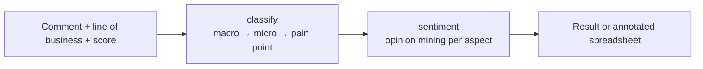

# NPS Verbatim Classifier

Classifies customer and broker NPS comments into the company's category tree (macro, micro and pain point) and runs opinion-level sentiment analysis, combining classic ML, a fine-tuned LLM and Azure AI Language.

**Stack:** Python · scikit-learn (TF-IDF + LinearSVC, classifier chains) · fine-tuned Azure OpenAI GPT-4.1-mini · Azure AI Language (opinion mining) · LangGraph · pandas · Streamlit
**Role:** Lead developer: design and implementation
**Code status:** partial. The UI, training scripts and configuration are here; the customer and broker node folders and the trained `.joblib` models were not available when this portfolio was assembled, so the app does not run as is.

> Built at a large Brazilian insurer. The company is replaced by the fictional **Acme Seguros**, and every name, document and data point here is fictional. Code, prompts and UI are in Portuguese, written for Brazilian business teams.

## Problem

Thousands of free-text NPS comments arrived every month, from customers and from brokers, across every line of business. Classifying them by hand into the company's category tree was slow and inconsistent, so pain points surfaced late.

## What I built



- **Two ways to classify:** a fine-tuned GPT-4.1-mini classification model, and scikit-learn classifier chains (TF-IDF + LinearSVC) trained on the broker base, for both the NPS and the process categories. The training scripts are in `modelo_nps.py` and `modelo_processos.py`.
- **Hierarchical labels:** classifier chains keep macro, micro and pain point consistent with each other.
- **Sentiment and opinion mining** with Azure AI Language, so each comment shows what the customer liked or disliked, not just an overall score.
- **Score bands in code:** 0–6 detractor, 7–8 passive, 9–10 promoter.
- **Single comment or batch:** upload an Excel file and download it with every comment classified.

## Run it

The missing node folders and trained models are needed before the app can start. The entry point would be:

```bash
pip install -r requirements.txt
cp .env.example .env                               # Azure OpenAI + Azure AI Language
streamlit run agent.py
```

---
Part of my [AI engineering portfolio](https://github.com/lucasboliveirasipp).
